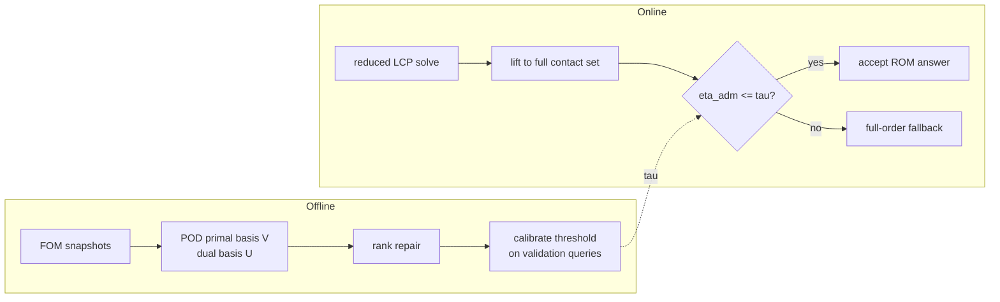

<h1 align="center">err-bound-contact-rom</h1>

<p align="center">
  <b>Can you trust a reduced-order contact model whose KKT residual is zero?</b><br>
  Lifted error bounds, admissibility screening and break-even analysis for Lagrange-multiplier reduced-order contact models.
</p>

<p align="center">
  
  
  
  
  
</p>

<p align="center">
  <a href="#the-problem">Problem</a> ·
  <a href="#what-the-package-provides">Features</a> ·
  <a href="#key-findings">Findings</a> ·
  <a href="#quick-start">Quick start</a> ·
  <a href="#experiments">Experiments</a> ·
  <a href="#saved-results">Results</a> ·
  <a href="#repository-layout">Layout</a>
</p>

---

## The problem

A reduced-order model (ROM) of contact can satisfy its **reduced KKT conditions to machine precision and still be
wrong**. With a signed dual basis (for example a truncated SVD of multiplier snapshots) the reduced multiplier
`lambda_r >= 0` can be lifted to a full-order multiplier `U lambda_r` with negative entries, which are tensile contact
tractions that cannot occur. The reduced residual is then tiny, the answer is inadmissible, and nothing flags it. We call
this a **silent failure**: reduced KKT residual below `1e-12` and relative energy-norm error above 5%.

This repository holds the code and saved results of a study that makes that failure measurable, detectable and costed.

## What the package provides

| | Component | In one line |
|---|---|---|
| 1 | **Lifted error bound** | A posteriori energy-norm upper bound for the lifted reduced pair (Theorem 1 of the manuscript), with an online-usable version based on an offline constant `C_lambda`. |
| 2 | **Admissibility indicators** | `eta_adm` and the unit-consistent `eta_adm,v2`: interface-only, cost `O(n_c (r_u + r_lambda))`, no full-order solve. |
| 3 | **Five dual bases** | Signed SVD, NMF, CPG, gIS and RID, each with rank repair, compared at matched dual dimension and at matched accuracy. |
| 4 | **Threshold calibration** | Several rules (relative, `0.9 min`, hybrid, percentile, cost-optimal) calibrated on validation queries, with recall, false-alarm rate and net speedup. |
| 5 | **Break-even cost model** | Operation-count model of full-order against reduced solves, checked against repeated single-thread timings. |
| 6 | **Circuit breaker** | Accepts the ROM answer only when the indicator stays below the threshold, otherwise falls back to the full-order solver. |



## Benchmarks

| ID | Problem | Dimension | Contact set |
|---|---|---|---|
| **B1** | 60-node spring chain above a parabolic rigid obstacle | 1D | every second node |
| **B2** | Membrane above an obstacle, partial contact patch | 2D | grid interface |
| **B3** | Two elastic bodies (Hex8 solids), mesh sweep up to `N = 16 653` | 3D | body-to-body interface |
| **B4** | Single elastic block clamped on its sides, resting on a rigid curved foundation; constant stiffness, moving contact patch (`N = 3375`, `n_c = 225`) | 3D | bottom face |

## Key findings

- **Silent failure is real and basis-dependent.** In the seed-42 audits signed SVD fails silently on every test
  query of B1 and B2, while non-negative bases (NMF, CPG, gIS, RID) fail far less often but not never.
- **The bound is valid, the indicator is a screen.** The certified bound is never below the true error, but it is tight
  only for some bases. The admissibility indicator is a calibrated statistic, not a bound.
- **No threshold rule removes the trade-off** between missed failures and unnecessary full-order fallbacks. A few
  failures of gIS on B2 have an indicator so small that no usable threshold catches them.
- **Screening can cost more than it saves.** On the 2D membrane at `N = 324` the net speedup after fallbacks can fall below
  one for several bases. A net gain appears only with varying stiffness or on larger meshes.
- **Memory.** On B3 at `N = 16 653` the sparse factorization plus dense contact block stores about 109 MiB against 0.12 MiB
  for the online reduced model (39 times less even when the primal basis is kept). On B2 most of the full-order storage
  is the dense `n_c x n_c` block, not fill-in.

Negative results are part of the study and are reported as such.

## Quick start

The package needs Python 3 with `numpy`, `scipy` and `matplotlib`, plus two packages from the authors' computation
suite that are **not on PyPI and not included here**:

- `fea_engine` (1.0.1): finite-element assembly and the exact contact solvers;
- `rom_engine` (0.2.0): reduced contact models and the active-set LCP solver.

```bash
python -m venv .venv
.venv/bin/pip install numpy scipy matplotlib          # Windows: .venv\Scripts\pip
.venv/bin/pip install -e <path-to>/computation-suite/fea_engine -e <path-to>/computation-suite/rom_engine

python -m contact_rom e1 --bench b1                   # first experiment: silent-failure audit on the spring chain
```

Reported results were produced with Python 3.14.3, NumPy 2.5.4 and SciPy 1.18.1. Every run writes these versions and its
configuration to `results/<run>/config.json`.

## Experiments

Run all commands from the repository root. `python -m contact_rom` pins BLAS and OpenMP to one thread, which the timing
experiments require. Time studies must run alone, one process at a time. Runtimes are rough values from one Windows
machine.

| Command | What it does | Runtime |
|---|---|---|
| `python -m contact_rom e1 --bench b1` | Silent-failure audit, signed SVD against NMF | minutes |
| `python -m contact_rom e3 --bench b1` (and `b2`) | Five-basis comparison, bound and indicator tables | minutes |
| `python -m contact_rom e4 --bench b2` (and `b3`) | Break-even model against timings, mesh-size sweep | minutes (B3: 10 to 15) |
| `python -m contact_rom e5 --bench b3 --kinds svd,nmf,cpg,gis,rid --r-dual 8,16 --tag b3_e5_all` | Circuit breaker, all five bases, in-range and extrapolated queries (the default is NMF and CPG, folder `b3_e5`) | about 15 min |
| `python -m contact_rom e5 --bench b3 --kinds nmf,cpg --r-dual 8,16 --e5-n 100 --tag b3_e5_n100` | Same, NMF and CPG with 100 queries per set (finer fallback shares) | about 1 h |
| `python -m contact_rom e1` / `e3` / `extrap` / `calibration --bench b4` | Audit, five-basis comparison, out-of-range and calibration studies on the independent 3D block | minutes to 35 min |
| `python -m contact_rom summary` | Scores the acceptance criteria on B1 and B2 | about a minute |
| `python -m contact_rom robustness` | Criteria over five seeds, 40 and 200 validation queries | 15 to 30 min |
| `python -m contact_rom calibration --bench b1` (and `b2`) | Calibration study, eight seeds, five threshold rules | long |
| `python -m contact_rom basiscomp --bench b1` (and `b2`) | Matched-dimension and matched-accuracy comparison | long |
| `python -m contact_rom timingstudy --bench b2` (and `b3`) | Ten repeated timings with bootstrap intervals | long |
| `python -m contact_rom ablation --bench b1` (and `b2`) | Primal-only, no repair, repair, screened | long |
| `python -m contact_rom extrap --bench b1` (and `b2`) | Out-of-range and contact-patch translation | long |
| `python -m contact_rom mesh --bench b1` (and `b2`) | Mesh-size study | long |

B3 can be run on smaller meshes for development with `--b3-n-xy` and `--b3-nz`.

## Saved results

`results/` holds the outputs behind the numbers in the manuscript (about 14 MB of `.npz`, pickle and JSON files):

| Folder | Content |
|---|---|
| `b1_e1`, `b2_all` | Silent-failure audits |
| `b1_e3`, `b2_e3` | Five-basis audits: errors, bounds, indicators |
| `b1_e4`, `b2_e4`, `b3_e4` | Break-even sweeps |
| `b3_e5`, `b3_e5_all`, `b3_e5_n100` | Circuit-breaker runs (`b3_e5_all`: five bases, 25 queries per set; `b3_e5_n100`: NMF and CPG, 100 queries per set, used for Figure 15) |
| `b4_e1`, `b4_e3` | Audits on the independent 3D benchmark B4 |
| `calibration` | Per-seed audits and analyses of the calibration study |
| `basis_comparison`, `ablation` | Matched-basis comparison and ablation |
| `timing_study`, `scale_study`, `robustness` | Repeated timings, extrapolation and mesh-size studies, multi-seed criteria |
| `memory_study` | Stored entries of the sparse factorization against the reduced dense model |

Re-running a command overwrites the matching folder.

## Repository layout

```
contact_rom/
├── benchmarks.py, benchmark_3d.py      B1/B2, B3 and B4 problem definitions
├── fom.py                              full-order contact solve and KKT checks
├── bases.py, dual_bases.py, repair.py  snapshots, POD, the five dual bases, rank repair
├── estimator.py                        error bound and admissibility indicators
├── audit.py, metrics.py                per-query audits (error, residual, indicators, bounds)
├── calibration*.py                     threshold rules and the calibration study
├── cost.py, timing*.py                 break-even cost model and timing studies
├── break_even_experiment.py, scale_study.py, ablation.py, basis_comparison.py
├── circuit_breaker.py                  screening with full-order fallback
└── run.py                              command-line entry point (python -m contact_rom ...)
results/                                saved outputs, one folder per experiment
```

The manuscript, its figure and table generators and the working notes are kept outside this repository.

## Conventions

Sign convention: `K u + B^T lambda = f`, `B u <= c`, `lambda >= 0`. `bound1` uses the exact full-order multiplier norm and
is a validation quantity. `bound_Clam` replaces that norm by the offline constant `C_lambda` (the largest multiplier norm
among the training snapshots); it is the version usable online and is rigorous only while the query multiplier norm stays
below `C_lambda`.

## Scope

Frictionless unilateral contact, direct factorization in the full-order solver, single-thread timings on one machine.
Break-even sizes are specific to this code and machine and are estimates, not predictors of absolute speedup. Iterative
full-order solvers and time-dependent dynamics are not covered.

## License and citation

Released under the MIT License (see `LICENSE`). A citation entry will be added when the manuscript is published.
